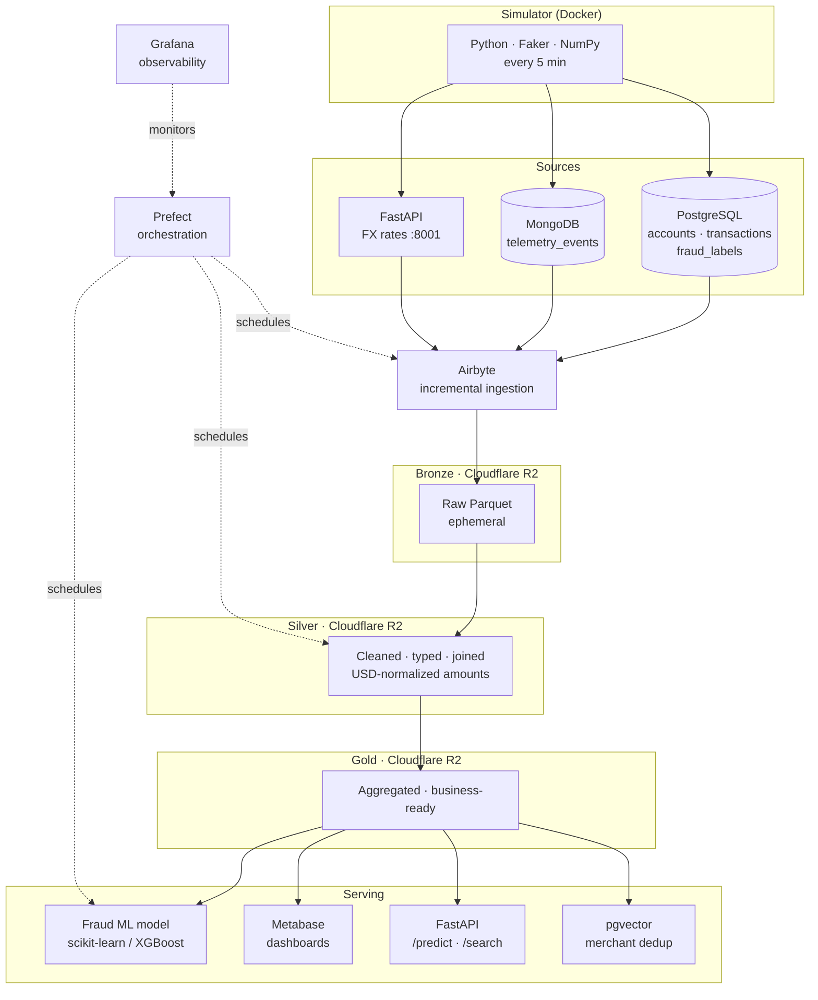
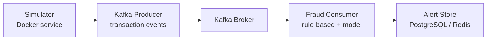

# PayFlow Data Platform

End-to-end data engineering platform for **PayFlow**, a fictional digital-payments fintech. Built on synthetic data and a 100% free, open-source stack. Covers the full data lifecycle: ingestion from heterogeneous sources, a cloud lakehouse with Medallion architecture, ML-powered fraud detection, pipeline orchestration, and a real-time streaming layer.

## Architecture

A real fintech runs two parallel data pipelines. This project implements both.

### Batch Analytics Pipeline

Feeds BI dashboards, model training, and analytical queries. Latency: hours.



### Streaming Layer (Phase 7)

Feeds real-time fraud alerts and operational dashboards. Latency: milliseconds.



Both pipelines share the same simulator and fraud logic. The batch pipeline is for analytics and model training; the streaming pipeline is for operational decisions made before the payment clears.

## Why this project

Most portfolio projects show one tool in isolation. This one shows how the tools compose: the simulator feeds real incremental data into Airbyte, Airbyte lands Parquet in R2, dbt models Silver and Gold on top of DuckDB, Prefect orchestrates the whole chain, and a FastAPI endpoint serves the trained model. The streaming layer shows the same domain problem solved with a different latency requirement.

The fraud label design is intentional: `fraud_labels` lives in a separate table because in production, fraud truth arrives days later via chargebacks and analyst review, never at transaction time. Mixing it with `transactions` would be an architectural error that breaks any downstream ML model.

## Evidence

Screenshots captured at key milestones as proof of the system running end-to-end.

### Phase 2 - Bronze layer live in Cloudflare R2 (2026-11-04)

22 MB across three source folders after the first Airbyte sync. All four streams landed as Parquet (accounts, transactions, fraud_labels from Postgres; telemetry_events from MongoDB; fx_rates from the custom CDK connector).


## Stack

| Layer | Tool |
| --- | --- |
| Data simulation | Python, Faker, NumPy |
| Sources | PostgreSQL 16, MongoDB 7, FastAPI |
| Ingestion | Airbyte (incremental + full-refresh) |
| Lakehouse storage | Cloudflare R2 (Parquet, SNAPPY) |
| Transform / compute | dbt + DuckDB |
| Orchestration | Prefect |
| Machine learning | scikit-learn / XGBoost |
| Serving | FastAPI |
| Vector search | pgvector + sentence-transformers |
| BI | Metabase |
| Observability | Grafana |
| Streaming (Phase 7) | Apache Kafka |
| Governance | dbt tests, contracts, Great Expectations |
| CI | GitHub Actions |

## Repository layout

| Path | Role | Phase |
| --- | --- | --- |
| `simulator/` | Synthetic transaction and fraud generator | 1 |
| `sources/postgres/` | Schema: accounts, transactions, fraud_labels | 1 |
| `sources/fx-api/` | FX rates microservice (FastAPI, port 8001) | 1 |
| `ingestion/` | Airbyte connection definitions | 2 |
| `transform/` | dbt project: Bronze to Silver to Gold | 3 |
| `orchestration/` | Prefect flows | 4 |
| `serving/` | FastAPI: /predict, query API, vector search | 5-6 |
| `streaming/` | Kafka producer and fraud consumer | 7 |
| `infra/` | docker-compose, env templates | 0 |

## Build status

| Phase | Description | Status |
| --- | --- | --- |
| 0 | Repo foundations, Docker Compose, env setup | Done |
| 1 | Simulator: Postgres + MongoDB + FX API running | Done |
| 2 | Airbyte ingestion to R2 Bronze (Parquet) | In progress |
| 3 | dbt + DuckDB: Silver and Gold models + PII masking + data contracts | Pending |
| 4 | Prefect orchestration + Grafana observability | Pending |
| 5 | Fraud ML model + MLflow model registry + FastAPI /predict | Pending |
| 6 | pgvector merchant deduplication | Pending |
| 7 | Kafka streaming layer (real-time fraud alerts) | Planned |
| 8 | CI: GitHub Actions running dbt tests + Great Expectations on every PR | Planned |
| 9 | dbt docs deployed to GitHub Pages (data lineage public) | Planned |

## Running locally

Requires Docker Desktop.

```bash
cp .env.example .env
# fill in R2_ACCOUNT_ID, R2_ACCESS_KEY_ID, R2_SECRET_ACCESS_KEY in .env
docker compose up -d
```

The simulator starts immediately and writes a batch every 5 minutes. FX rates are available at `http://localhost:8001/rates`. Airbyte runs at `http://localhost:8000`.

## Design decisions

**fraud_labels lives in a separate table.**
In production, fraud truth arrives days or weeks after the transaction via chargebacks and analyst review, never at payment time. Embedding it in `transactions` would create a data leakage problem for any downstream ML model and misrepresents how fintech data actually flows.

**Incremental sync for transactional tables, full refresh for telemetry.**
`accounts`, `transactions`, and `fraud_labels` use incremental append in Airbyte: each sync adds only new records, so the Bronze layer accumulates history. `telemetry_events` in MongoDB uses full refresh because the collection is overwritten by the simulator on each run and historical event logs have no business value at this scale.

**FX rates ingested via Airbyte Connector Builder, not written to Postgres.**
The FX API simulates an external data provider (like Open Exchange Rates or a bank feed). In production you would never ask a third-party API to write directly to your database; you build a connector that pulls from it on a schedule. The Connector Builder approach reflects that boundary correctly and demonstrates custom connector development.

**Cloudflare R2 as the lakehouse storage layer.**
R2 is S3-compatible and has no egress fees, making it the right choice for a portfolio project that needs to demonstrate cloud lakehouse patterns without incurring costs. In production the same architecture runs on S3, GCS, or ADLS with no changes to the dbt or DuckDB layer.

**DuckDB for compute, not Spark.**
The dataset is synthetic and small. DuckDB reads Parquet directly from R2 via the httpfs extension, executes dbt models, and writes Silver and Gold back to R2 without a cluster. For a production fintech at scale, the same Medallion models run on Spark or BigQuery with minimal changes to the SQL.

## Development tools

[DBeaver Community](https://dbeaver.io/) is used to inspect the Postgres and MongoDB sources during development. If you have a local PostgreSQL service on port 5432, stop it before connecting DBeaver to the Docker instance.
