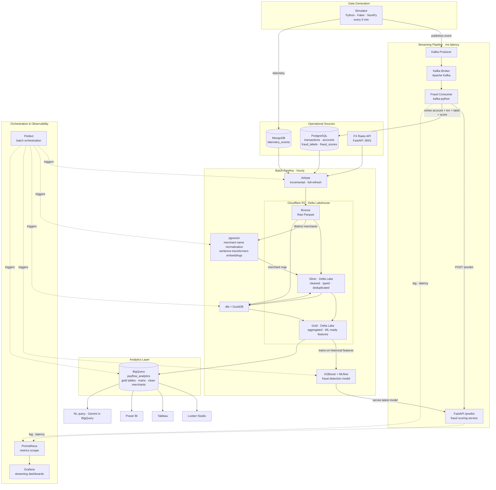
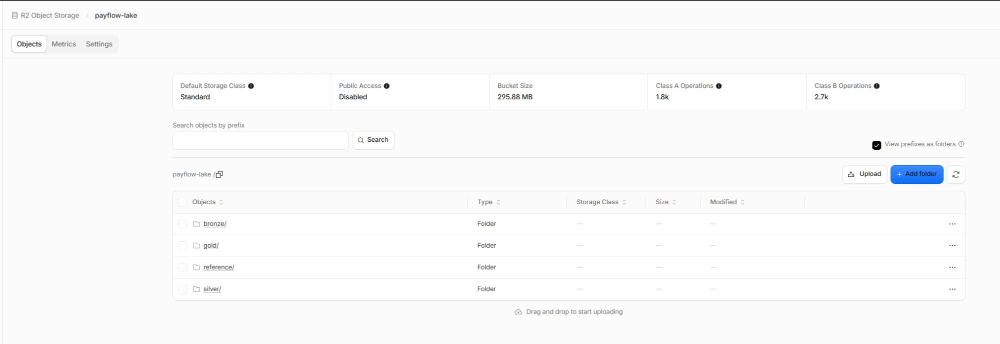
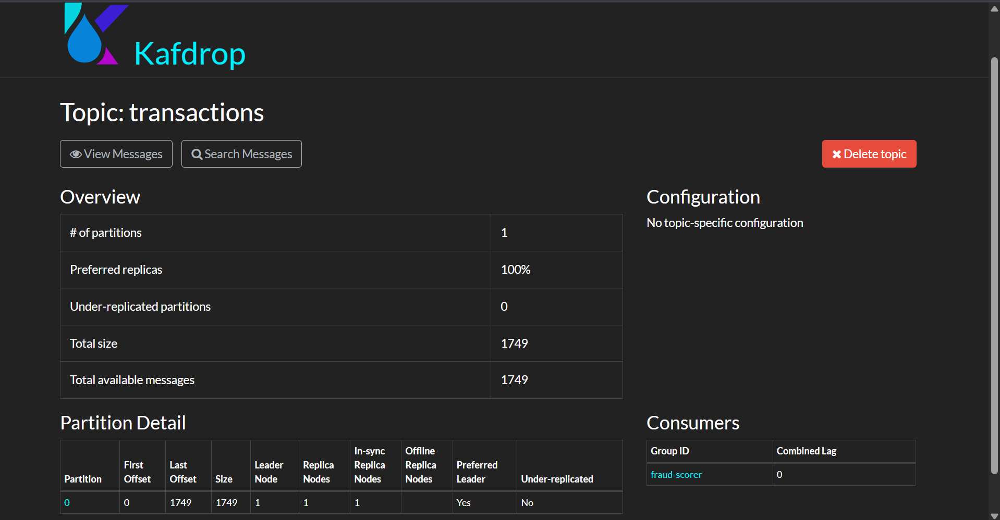
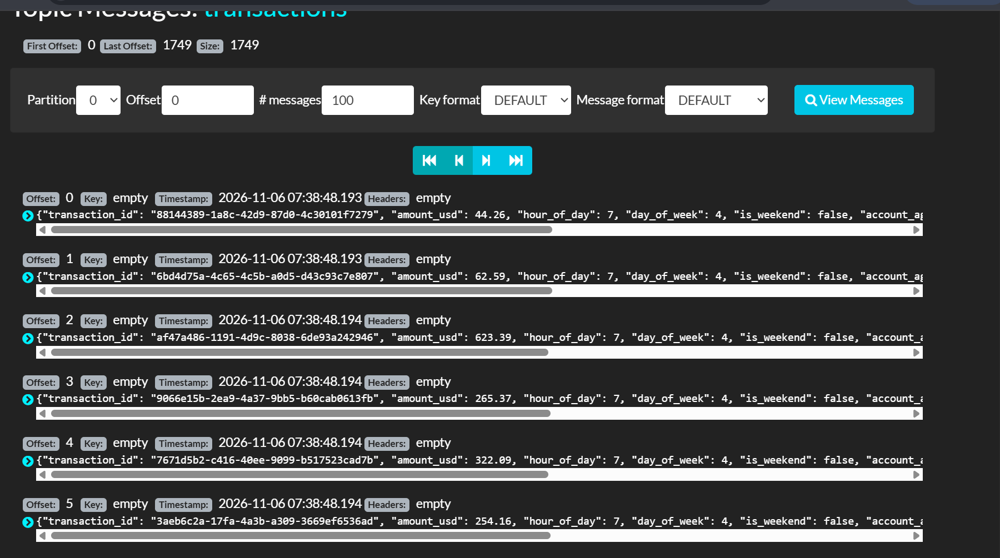
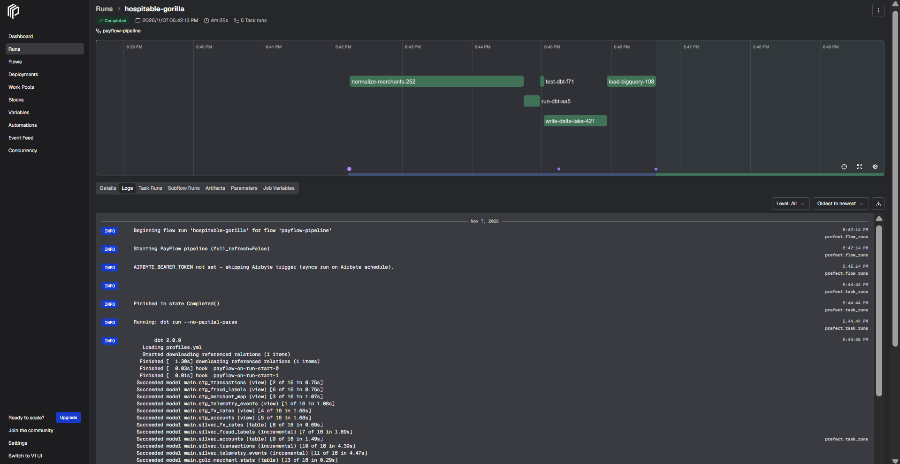
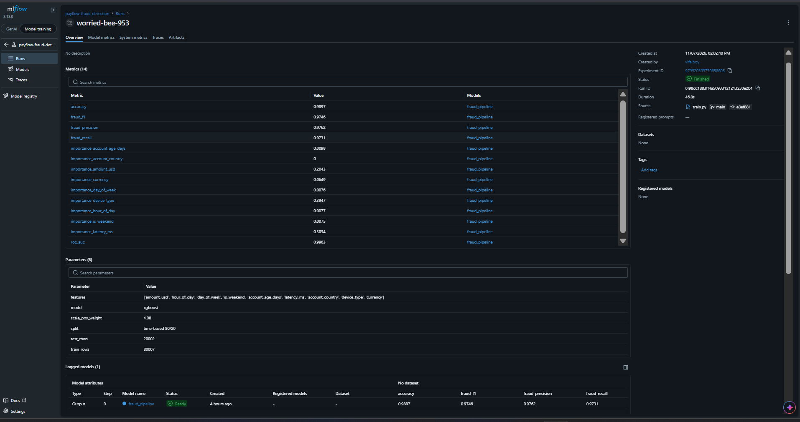
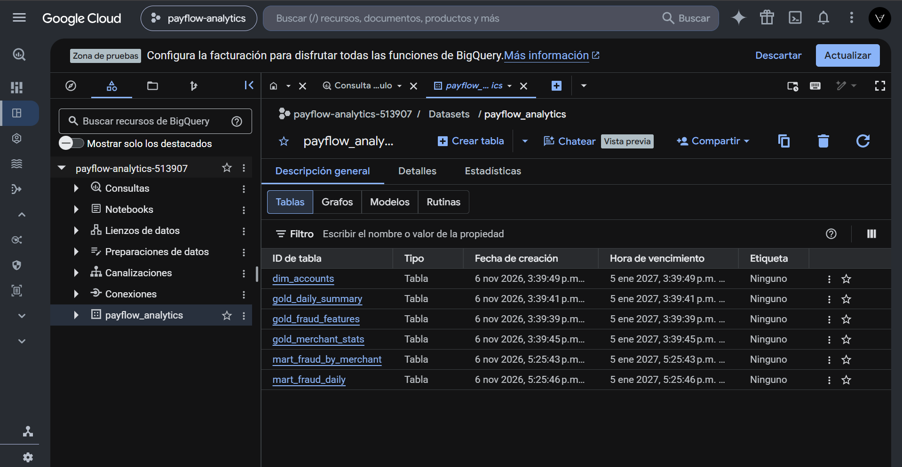
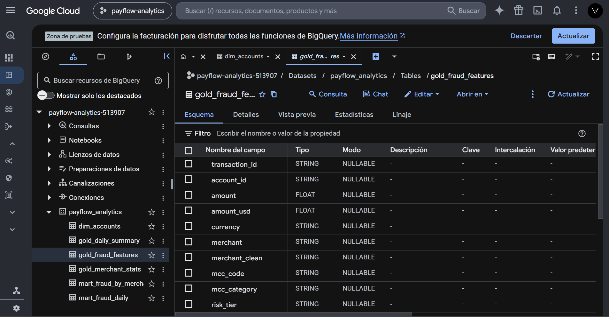
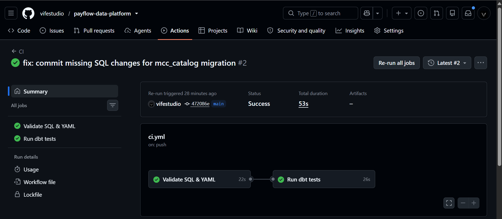

# PayFlow Data Platform

End-to-end data engineering platform for **PayFlow**, a fictional digital-payments fintech. Built on synthetic data and a 100% free, open-source stack. Covers the full data lifecycle: real-time ingestion, a cloud lakehouse with Medallion architecture, ML-powered fraud detection, pipeline orchestration, and a streaming layer for millisecond-latency decisions.

## Architecture

A real fintech runs two parallel pipelines. PayFlow implements both.



The batch pipeline trains the model on historical Gold features. The streaming pipeline scores each transaction in real time using that model before the payment clears. The fraud score is written back to PostgreSQL, where Airbyte picks it up in the next sync cycle; that feedback becomes part of the next training run, closing the loop. Retraining is automatic: the last step of every Prefect run counts how many new rows have accumulated in `gold_fraud_features` since the previous training and triggers `train.py` whenever the threshold is met (default 1,000 rows, configurable via `MIN_RETRAIN_ROWS`). The checkpoint is stored in `ml/last_trained_rows.txt`.

Gold data is loaded into BigQuery as the analytical warehouse after merchant names are normalized via pgvector. Looker Studio connects natively to BigQuery for dashboards and reporting.

## Stack

| Layer | Tool |
| --- | --- |
| Data simulation | Python, Faker, NumPy |
| Operational sources | PostgreSQL 16, MongoDB 7, FastAPI |
| Ingestion | Airbyte (incremental + full-refresh) |
| Lakehouse storage | Cloudflare R2 (Parquet + Delta Lake) |
| Transform / compute | dbt + DuckDB |
| Orchestration | Prefect |
| Machine learning | XGBoost + scikit-learn + MLflow |
| Real-time serving | Apache Kafka + FastAPI |
| Merchant normalization | pgvector + sentence-transformers |
| Analytical warehouse | BigQuery |
| BI | Looker Studio |
| Observability | Prefect UI (batch) + Grafana / Prometheus (streaming) |
| Data quality | dbt tests |
| CI | GitHub Actions |

## Repository layout

| Path | Role |
| --- | --- |
| `simulator/` | Synthetic transaction and fraud generator (`bulk_seed.py` for the historical bootstrap) |
| `sources/postgres/` | Schema: accounts, transactions, fraud_labels, fraud_scores |
| `sources/fx-api/` | FX rates microservice (FastAPI, port 8001) |
| `ingestion/fx-connector/` | Custom Airbyte CDK connector for the FX API |
| `transform/` | dbt project: Bronze → Silver → Gold → marts |
| `orchestration/` | Prefect flow: normalize → dbt → write-delta → BigQuery |
| `ml/` | XGBoost training (`train.py`) and FastAPI scoring service (`serve.py`) |
| `streaming/` | Kafka fraud consumer: scores each transaction, writes to Postgres |
| `infra/` | Prometheus scrape config and Grafana dashboards for the streaming plane |
| `notebooks/` | EDA over Gold tables (BigQuery) |
| `scripts/` | Utilities: `abort_multipart.py`, `generate_mcc_catalog.py` |

## Running locally

Requires Docker Desktop.

```bash
cp .env.example .env
# fill in R2_ACCOUNT_ID, R2_ACCESS_KEY_ID, R2_SECRET_ACCESS_KEY in .env
docker compose up -d
```

The simulator starts immediately and writes a batch every 5 minutes. FX rates are available at `http://localhost:8001/rates`, Airbyte runs at `http://localhost:8000`, and the streaming dashboards are at `http://localhost:3001` (Grafana) over `http://localhost:9090` (Prometheus).

## Design decisions

**PII is hashed before it leaves the operational database.**
`email` and `holder_name` are SHA-256 hashed in `silver_accounts` before the data moves to R2 or BigQuery. The raw values exist only in PostgreSQL (the operational system of record). In production, the hash would use a secret salt to prevent rainbow-table reversal; this project omits the salt as a portfolio simplification but preserves the correct architectural boundary: PII never reaches the lakehouse or the analytical warehouse in plaintext.

**fraud_labels lives in a separate table.**
In production, fraud truth arrives days or weeks after the transaction via chargebacks and analyst review, never at payment time. Embedding it in `transactions` would create data leakage for any downstream ML model and misrepresents how fintech data actually flows.

**Incremental sync for transactional tables, full refresh for telemetry.**
`accounts`, `transactions`, and `fraud_labels` use incremental append in Airbyte (the Postgres source tracks new rows by `xmin`), so each sync adds only new records and Bronze accumulates history. `telemetry_events` uses full refresh: the MongoDB source runs as a standalone instance, so Airbyte's change-stream (CDC) incremental, which requires a replica set, is not available; at this event volume a full reload each sync is cheap and keeps the connector simple. dbt then deduplicates and accumulates telemetry in the Silver layer regardless of the Bronze sync mode.

**FX rates ingested via Airbyte Connector Builder, not written to Postgres.**
The FX API simulates an external data provider. In production you would never ask a third-party API to write directly to your database; you build a connector that pulls from it on a schedule. The Connector Builder approach reflects that boundary correctly and demonstrates custom connector development.

**Cloudflare R2 as the lakehouse storage layer.**
R2 is S3-compatible with no egress fees, making it the right choice for a portfolio project that needs to demonstrate cloud lakehouse patterns without incurring costs. In production the same architecture runs on S3, GCS, or ADLS with no changes to the dbt or DuckDB layer.

**DuckDB for compute, not Spark.**
The dataset is synthetic and small. DuckDB reads Parquet directly from R2 via the httpfs extension, executes dbt models, and writes Silver and Gold back to R2 without a cluster. For a production fintech at scale, the same Medallion models run on Spark or BigQuery with minimal changes to the SQL.

**Data lake and analytical warehouse are separate layers.**
Cloudflare R2 holds the full history as Delta Lake files: cheap, durable, queryable by DuckDB. BigQuery holds only the Gold tables, optimized for fast analytical queries and BI tools. This is the standard lakehouse pattern: the lake owns the data, the warehouse owns the queries. R2 is equivalent to S3 or GCS in this role; swapping it out requires no changes to the dbt or DuckDB layer.

**pgvector for merchant normalization, not for the fraud model.**
Merchant names in the raw data are dirty: "Amazon", "AMAZON.COM", "AMZN Marketplace", and "amazon.com*Digital" are the same merchant. pgvector generates sentence-transformer embeddings for each raw name and finds the nearest canonical name by cosine similarity. This normalization runs in the Prefect pipeline before Gold is loaded into BigQuery, so Looker Studio dashboards show clean merchant names. The fraud model deliberately excludes merchant as a feature; dirty names at training time would not generalize to unseen variants at inference time.

**Model bootstrapped on a 200k historical seed, then retrained automatically.**
A fraud model needs enough labeled history to learn from before it can score anything. The first model is trained on a one-time seed of 200,000 transactions spanning 365 days (`simulator/bulk_seed.py`). Fraud is skewed by merchant category the way real card-testing is: digital-goods merchants (gaming, software, streaming) carry a high fraud rate while in-person, low-value categories (fuel, food) stay near zero, so the labels have genuine structure instead of uniform noise. After bootstrap, every Prefect pipeline run checks whether `gold_fraud_features` has grown by at least `MIN_RETRAIN_ROWS` (default 1,000) since the last training. When the threshold is met, `train.py` runs automatically as the final pipeline step, logs the new run to MLflow, and overwrites `ml/model/fraud_pipeline.joblib`. The FastAPI scoring service reloads the model on the next request because it loads the artifact at startup; to pick up the new artifact without downtime, the service is restarted by the pipeline after training via a `docker compose restart ml-service` call. The checkpoint (`ml/last_trained_rows.txt`) persists between runs so the trigger is monotonic: each retrain builds on more labeled history than the last.

**Synchronous authorization vs asynchronous analytics.**
The customer-facing approve/decline answer belongs to the operational plane: a payments backend would call the fraud scoring API (`/predict`) synchronously and return the decision in the same request, in milliseconds, while persisting the transaction and its decision to Postgres. The lakehouse (R2) and warehouse (BigQuery) are never in that request path; they are the analytical plane that Airbyte populates downstream for monitoring, dashboards and retraining. This project implements the data engineering side: real-time scoring, the batch lakehouse, and the warehouse. The authorization backend itself (an `/authorize` endpoint that returns the decision to the client) is backend engineering and is intentionally out of scope, noted here to show where the data pipeline fits in the full system.

**Two pipelines, one model.**
The batch pipeline trains the fraud model on historical Gold features; the streaming pipeline serves that same artifact for real-time decisions. `train.py` logs every run to MLflow (metrics, params, feature importances) and writes the fitted pipeline to `ml/model/`, which the FastAPI service loads at startup. In production MLflow's model registry would gate promotion between the two; here the file handoff keeps the same train-once, serve-many boundary without the extra registry infrastructure.

**Silver is incremental; Gold is a full rebuild.**
`silver_transactions` uses dbt's `delete+insert` incremental strategy: each run appends only new rows so Bronze history accumulates in Silver. Gold tables are rebuilt from scratch on every run because they are aggregates; recomputing them in full is cheaper than merging deltas and avoids stale rollup bugs.

**MCC category yes, merchant name no.**
The fraud model includes `mcc_category` and `risk_tier` as features but deliberately excludes `merchant` and `merchant_clean`. Merchant names in raw data are dirty: "Amazon", "AMAZON.COM", and "amzn marketplace" are the same merchant but would appear as three different categorical values to the model. Dirty names at training time would not generalize to unseen variants at inference time. MCC codes are stable, normalized via the `mcc_catalog` seed, and carry genuine signal about transaction risk.

**Fraud scoring thresholds.**
The ML service applies three thresholds to the model's output probability: `approve` (< 0.30), `review` (0.30–0.69), `decline` (≥ 0.70). These are configurable via environment variables (`REVIEW_THRESHOLD`, `DECLINE_THRESHOLD`). A separate `FRAUD_THRESHOLD` (default 0.50) controls the boolean `is_fraud` flag independently of the authorization decision; a transaction can be in `review` without being flagged as fraud yet.

## Evidence

### Cloudflare R2: Medallion lake structure

Four layers live in R2 after a full pipeline run: `bronze/` (raw Parquet from Airbyte), `silver/` (cleaned, typed, deduplicated Delta Lake), `gold/` (aggregated ML-ready features), and `reference/` (merchant map written by pgvector normalization).



### Airbyte connections all green

Three connections running every 6 hours: MongoDB, PayFlow FX Rates API (custom CDK connector), Postgres. All enabled, all healthy.


### Kafka: 1,749 transactions in flight

Kafdrop shows the `transactions` topic with 1,749 messages and consumer group `fraud-scorer` at lag 0, meaning the streaming consumer is fully caught up. Each message carries the full transaction payload: `transaction_id`, `amount_usd`, behavioral features, and account metadata.





### Prefect: full pipeline completed

End-to-end Prefect run with all 5 tasks green: `normalize-merchants`, `run-dbt`, `test-dbt`, `write-delta-lake`, `load-bigquery`. The Gantt shows each task's duration. dbt ran 16 models across staging, silver, and gold layers.



### Grafana: real-time streaming observability

Prefect covers the batch plane; Grafana covers the streaming plane. The fraud consumer and the `/predict` service expose Prometheus metrics that Grafana renders live: `/predict` latency (p50/p95), scoring throughput by decision, Kafka consumer lag, and the approve/review/decline split. Metrics, scrape config and the provisioned dashboard live in `infra/`.


### MLflow: fraud detection model metrics

XGBoost pipeline trained on 160,000 transactions (time-based 80/20 split, 40,000 held out). Top features by importance: `latency_ms` (0.36), `amount_usd` (0.35), `currency` (0.21).

| Metric | Value |
| --- | --- |
| ROC-AUC | 0.9948 |
| Accuracy | 0.9861 |
| Fraud Precision | 0.926 |
| Fraud Recall | 0.969 |
| Fraud F1 | 0.947 |

> **On the high scores:** fraud concentrates in card-testing bursts on digital-goods merchants, and those bursts carry a clear behavioral signature (tiny amounts, low latency) that the model picks up even though it never sees the merchant or MCC category. The ~0.99 ROC-AUC reflects that learnable synthetic signature, not real-world fraud difficulty, where precision and recall are far harder to move; precision here already sits at 0.93, not a perfect score. What carries over to a real dataset is the methodology: a time-based split to prevent leakage, `scale_pos_weight` for class imbalance, and no PII or merchant-name features.



### BigQuery: Gold tables loaded

> **Note:** BigQuery Sandbox datasets expire after 60 days. If the tables are gone, re-run `python transform/load_to_bigquery.py` after `gcloud auth application-default login`.

Nine tables in the `payflow_analytics` dataset: the Gold feature tables (`gold_fraud_features`, `gold_daily_summary`, `gold_merchant_stats`), the star schema (`fct_transactions`, `dim_merchants`, `dim_date`, `dim_accounts`), and the BI marts (`mart_fraud_by_merchant`, `mart_fraud_daily`). Loaded from the DuckDB Gold/mart layer via `load_to_bigquery.py` using Application Default Credentials.





### EDA: Gold fraud features

Exploratory analysis over `gold_fraud_features` loaded from BigQuery into a Jupyter notebook ([`notebooks/eda_gold.ipynb`](notebooks/eda_gold.ipynb)).

Sections:
- Fraud rate trend: daily volume and fraud rate over 366 days
- Amount distribution: fraud transactions skew toward the tails
- Fraud rate by device type, MCC category, account type, and currency (the same features that drive the XGBoost model)
- Fraud by hour of day
- Fraud pattern breakdown (`card_testing`, `geo_impossible`, `amount_anomaly`)
- Numeric feature correlation matrix

> **Note:** requires `gcloud auth application-default login` and the BigQuery Sandbox dataset to still be active. If the dataset expired, re-run `python transform/load_to_bigquery.py` first.

### GitHub Actions CI: both jobs green

`dbt parse` validates SQL and YAML on every push without touching R2. `dbt seed + run + test` runs on main with real R2 credentials. Total duration: 53s.



### Looker Studio: fraud analytics dashboard


