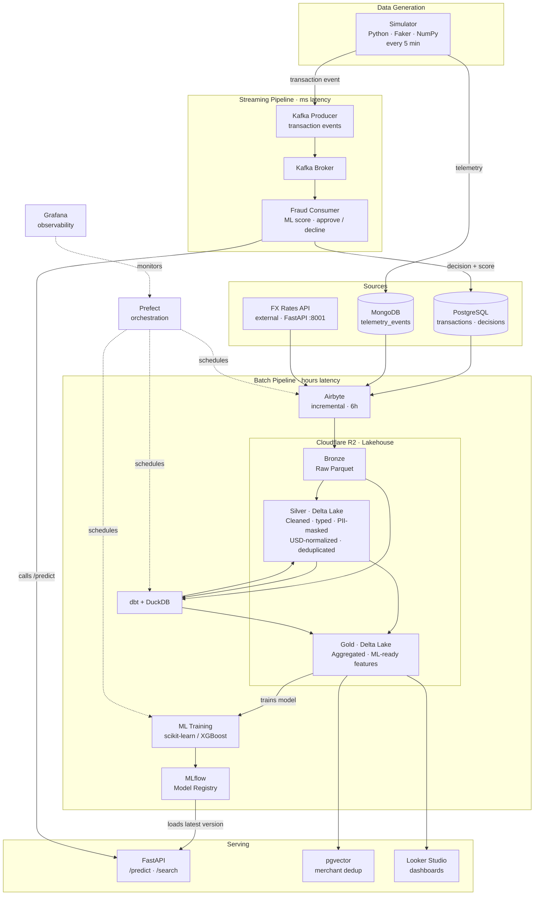

# PayFlow Data Platform

End-to-end data engineering platform for **PayFlow**, a fictional digital-payments fintech. Built on synthetic data and a 100% free, open-source stack. Covers the full data lifecycle: real-time ingestion, a cloud lakehouse with Medallion architecture, ML-powered fraud detection, pipeline orchestration, and a streaming layer for millisecond-latency decisions.

## Architecture

A real fintech runs two parallel pipelines. PayFlow implements both.



The batch pipeline trains the model on historical Gold features. The streaming pipeline scores each transaction in real time using that model — before the payment clears. The decision result (approved/declined + fraud score) is written back to PostgreSQL, where Airbyte picks it up in the next sync cycle. That feedback becomes part of the next training run, closing the loop: better data produces a better model, which produces better decisions, which produces richer training data.

## Stack

| Layer | Tool |
| --- | --- |
| Data simulation | Python, Faker, NumPy |
| Sources | PostgreSQL 16, MongoDB 7, FastAPI |
| Ingestion | Airbyte (incremental + full-refresh) |
| Lakehouse storage | Cloudflare R2 (Parquet + Delta Lake) |
| Transform / compute | dbt + DuckDB |
| Orchestration | Prefect |
| Machine learning | scikit-learn / XGBoost + MLflow |
| Serving | FastAPI |
| Vector search | pgvector + sentence-transformers |
| BI | Looker Studio |
| Observability | Grafana |
| Streaming | Apache Kafka |
| Data quality | dbt tests + Great Expectations |
| CI | GitHub Actions |

## Repository layout

| Path | Role |
| --- | --- |
| `simulator/` | Synthetic transaction and fraud generator |
| `sources/postgres/` | Schema: accounts, transactions, fraud_labels |
| `sources/fx-api/` | FX rates microservice (FastAPI, port 8001) |
| `ingestion/` | Airbyte connection definitions |
| `transform/` | dbt project: Bronze → Silver → Gold |
| `orchestration/` | Prefect flows |
| `serving/` | FastAPI: /predict, /search, vector search |
| `streaming/` | Kafka producer and fraud consumer |
| `infra/` | docker-compose, env templates |

## Running locally

Requires Docker Desktop.

```bash
cp .env.example .env
# fill in R2_ACCOUNT_ID, R2_ACCESS_KEY_ID, R2_SECRET_ACCESS_KEY in .env
docker compose up -d
```

The simulator starts immediately and writes a batch every 5 minutes. FX rates are available at `http://localhost:8001/rates`. Airbyte runs at `http://localhost:8000`.

## Design decisions

**fraud_labels lives in a separate table.**
In production, fraud truth arrives days or weeks after the transaction via chargebacks and analyst review, never at payment time. Embedding it in `transactions` would create data leakage for any downstream ML model and misrepresents how fintech data actually flows.

**Incremental sync for transactional tables, full refresh for telemetry.**
`accounts`, `transactions`, and `fraud_labels` use incremental append in Airbyte: each sync adds only new records, so Bronze accumulates history. `telemetry_events` uses full refresh because MongoDB overwrites the collection on each run and historical event logs have no business value at this scale.

**FX rates ingested via Airbyte Connector Builder, not written to Postgres.**
The FX API simulates an external data provider. In production you would never ask a third-party API to write directly to your database; you build a connector that pulls from it on a schedule. The Connector Builder approach reflects that boundary correctly and demonstrates custom connector development.

**Cloudflare R2 as the lakehouse storage layer.**
R2 is S3-compatible with no egress fees, making it the right choice for a portfolio project that needs to demonstrate cloud lakehouse patterns without incurring costs. In production the same architecture runs on S3, GCS, or ADLS with no changes to the dbt or DuckDB layer.

**DuckDB for compute, not Spark.**
The dataset is synthetic and small. DuckDB reads Parquet directly from R2 via the httpfs extension, executes dbt models, and writes Silver and Gold back to R2 without a cluster. For a production fintech at scale, the same Medallion models run on Spark or BigQuery with minimal changes to the SQL.

**Two pipelines, one model.**
The batch pipeline trains the fraud model on historical Gold features. The streaming pipeline serves that same model for real-time decisions. MLflow is the bridge: batch registers a new version, FastAPI promotes it without redeployment. This is the standard MLOps pattern at any fintech operating at scale.

## Evidence

### Bronze layer live in Cloudflare R2

22 MB across three source folders after the first Airbyte sync. All streams landed as Parquet: accounts, transactions, fraud_labels from Postgres; telemetry_events from MongoDB; fx_rates from the custom CDK connector.


### Airbyte connections all green

Three connections running every 6 hours: MongoDB, PayFlow FX Rates API (custom CDK connector), Postgres. All enabled, all healthy.


