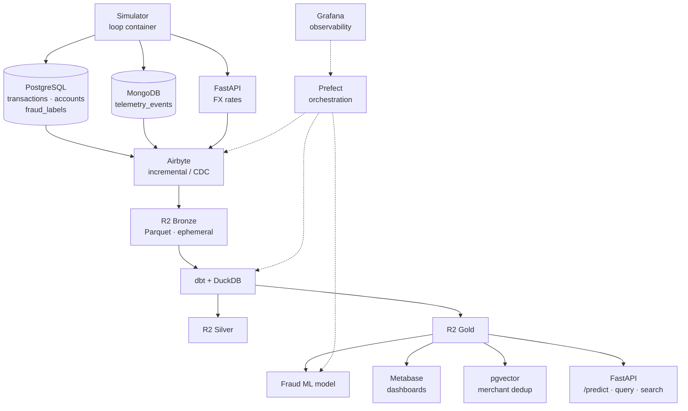

# PayFlow Data Platform

End-to-end data platform for **PayFlow**, a fictional digital-payments fintech. Built on synthetic data and a 100% free, open-source stack. This is a Data Engineering portfolio project covering the full lifecycle: ingestion, a lakehouse, Medallion modeling, orchestration, a served ML model, data governance, and CI.

## Architecture



## Why this project
It demonstrates a modern, production-shaped data stack well beyond a single notebook: real incremental ingestion from three heterogeneous sources, a lakehouse, Medallion architecture, orchestration, a served fraud model, data governance, and CI, all at zero monetary cost.

## Stack
| Layer | Tool |
| --- | --- |
| Sources | PostgreSQL, MongoDB, FastAPI |
| Data simulation | Python, Faker, NumPy |
| Ingestion | Airbyte |
| Lakehouse storage | Cloudflare R2 (Parquet) |
| Transform / compute | dbt + DuckDB |
| Orchestration | Prefect |
| Machine learning | Fraud detection (scikit-learn / XGBoost) |
| Serving | FastAPI |
| Vector search | pgvector + sentence-transformers |
| BI | Metabase |
| Observability | Grafana |
| Governance | dbt tests, contracts, docs, Great Expectations |
| CI | GitHub Actions |

## Repository layout
| Path | Role | Phase |
| --- | --- | --- |
| `simulator/` | Transaction and fraud generator (the external world) | 1 |
| `sources/postgres/` | Confirmed transactions and accounts | 1 |
| `sources/mongo/` | Telemetry events | 1 |
| `sources/fx-api/` | FastAPI FX rates source | 1 |
| `ingestion/` | Airbyte connections as code | 2 |
| `transform/` | dbt project (DuckDB over R2) | 3 |
| `orchestration/` | Prefect flows | 4 |
| `serving/` | FastAPI: /predict, query API, vector search | 5-6 |
| `infra/` | docker-compose, env, docs | 0 |

## Status
Phase 0 (foundations) in progress.

## Running locally
Requires Docker. Copy the env template and start the local sources:

```bash
cp .env.example .env
docker compose up -d
```
